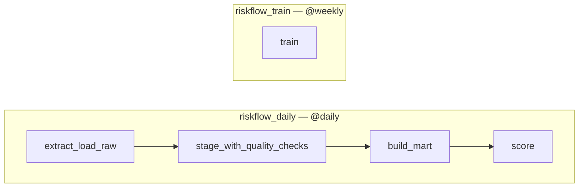
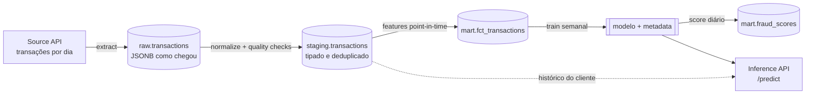

# RiskFlow

Pipeline de dados incremental para transações de cartão, com detecção de fraude como consumidor final.

Orquestrado com **Apache Airflow 3**, em camadas no **PostgreSQL**, com checagens de qualidade bloqueantes,
features point-in-time e CI de ponta a ponta. Tudo sobe com um comando.

## Rodando em 5 minutos

Requer Docker. Use 8 GB de RAM livres para o Docker.

```bash
docker compose up -d --build                     # Postgres, APIs, Airflow e dashboard

# Carga histórica: 4 meses, cerca de 85 mil transações, em ~2 min
docker compose run --rm pipeline backfill --start 2026-06-01 --end 2026-09-30
docker compose run --rm pipeline train
```

| Serviço | Endereço |
|---|---|
| Airflow UI (dev, sem login) | http://localhost:8080 |
| Dashboard (Streamlit) | http://localhost:8501 |
| Inference API (Swagger) | http://localhost:8000/docs |
| Source API (Swagger) | http://localhost:8001/docs |
| PostgreSQL | `localhost:5432`, usuário/senha `riskflow` |

No Airflow, ative `riskflow_daily` (diária) e `riskflow_train` (semanal). Para fazer backfill de um período pelo Airflow:

```bash
docker compose exec airflow airflow backfill create --dag-id riskflow_daily \
  --from-date 2026-10-02 --to-date 2026-10-08    # processa de 01/10 a 07/10, um dia por vez
```

Para testar a inferência online:

```bash
curl -X POST localhost:8000/predict -H 'content-type: application/json' -d '{
  "customer_id": "CUST_00007", "amount": 5200, "merchant": "Kabum",
  "category": "electronics", "card_network": "Visa", "timestamp": "2026-10-01T03:10:00"}'
```

## Orquestração



- **Cada execução processa o dia anterior** à sua data lógica, e só ele.
- **`depends_on_past` mais `max_active_runs=1`:** as features de um dia dependem do histórico dos dias anteriores. Sem isso, o backfill do Airflow 3 processa vários dias em paralelo e cria uma condição de corrida. Esse problema foi encontrado e corrigido durante a validação.
- **Retries:** 2 tentativas para falhas transitórias (origem fora do ar, por exemplo). A checagem de qualidade **não** tem retry, porque dado errado não se corrige tentando de novo.
- **Treino em processo isolado** (`@task.bash`): o Airflow importa o `dill`, que altera o pickler global. Se o treino rodasse dentro do processo do Airflow, o modelo salvo dependeria do `dill` e a API de inferência não conseguiria carregá-lo.
- **A lógica fica em `pipeline/` e `ml/`, não nas DAGs.** As tasks só chamam funções testáveis sem o Airflow, que também rodam pela CLI.

## Arquitetura



## Decisões de projeto

| Decisão | Motivo |
|---|---|
| **Processamento incremental por dia** | Cada execução processa apenas a sua data lógica. Isso permite agendar, reprocessar um dia e fazer backfill. |
| **Idempotência por substituição de partição** | Cada etapa apaga e regrava o dia, dentro de uma transação. Reexecutar não duplica dados. |
| **Origem determinística** | A mesma data sempre devolve as mesmas transações, com IDs UUIDv5. Isso torna o reprocessamento confiável. |
| **Camada `raw` com o payload original** | O `raw` é a fonte da verdade. Uma mudança na transformação pode ser reaplicada sem consultar a origem de novo. |
| **Qualidade de dados bloqueante** | Se uma checagem falha, o dia inteiro é rejeitado antes da staging. Um dia faltando é visível e alertável; um dia errado contamina o mart. |
| **Features point-in-time compartilhadas** | `ml/features.py` usa só transações anteriores e é a mesma função no batch, no treino e na API online. Isso evita vazamento de dados e divergência entre treino e produção. |
| **Split temporal por dia e seleção por PR-AUC** | A fraude representa cerca de 1% das transações, então acurácia não diz nada. O modelo é avaliado em dias posteriores aos de treino. |
| **Baseline obrigatório** | O modelo é comparado com a regra "valor acima do p95". Se não superar a regra, não se justifica. |

## Resultados (dados sintéticos, 120 dias, ~84 mil transações)

| | PR-AUC (teste) | Precision | Recall |
|---|---|---|---|
| Regra: valor > p95 | 0.063 | 0.069 | 0.355 |
| **HistGradientBoosting** | **0.935** | **0.958** | **0.760** |

**Limitações, ditas com honestidade:**
- Os dados são sintéticos. Os padrões de fraude (rajadas de compras pequenas, valores fora do perfil do cliente) são mais limpos do que no mundo real, então essas métricas são otimistas.
- O rótulo de fraude chega junto com a transação. Na prática, ele chega dias depois, por chargeback.

## Desenvolvimento e testes

```bash
pip install -r requirements-dev.txt   # Python 3.12
ruff check .
pytest                                # unitários + treino de ponta a ponta em memória
```

O CI (`.github/workflows/ci.yml`) roda três jobs a cada push:
1. **lint-and-test:** ruff e pytest.
2. **dags:** build da imagem do Airflow e verificação de que as DAGs importam sem erro.
3. **end-to-end:** sobe o Postgres e a Source API e roda backfill de 45 dias, depois verifica que reprocessar um dia não duplica dados, treina o modelo, pontua um dia novo e chama a API de inferência.

## Estrutura

```
source_api/   sistema de origem simulado (gerador determinístico + FastAPI)
pipeline/     extract, transform, quality, steps (raw -> staging -> mart) e CLI
ml/           features, treino, carregamento do modelo, API de inferência
sql/          schema versionado (idempotente)
tests/        testes unitários e de ponta a ponta do treino
dags/         DAGs do Airflow (só orquestram; a lógica está em pipeline/ e ml/)
docker/       imagem do Airflow e init do Postgres
dashboard/    Streamlit lendo o mart: visão geral, gráficos de fraude e métricas do modelo
```
