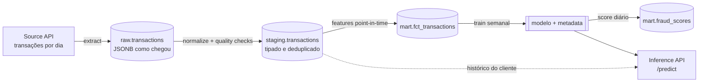

# RiskFlow

Pipeline de dados incremental para transações de cartão, com detecção de fraude como consumidor final.

> **Status: v2 em construção.** A fase 1 está concluída: pipeline, camadas, qualidade de dados, ML e testes.
> Ainda faltam o `docker compose`, a DAG do Airflow, o CI e a adaptação do dashboard.

## Arquitetura



## Decisões de projeto

| Decisão | Motivo |
|---|---|
| **Processamento incremental por dia** | Cada execução processa apenas a sua data lógica. Isso permite agendar, reprocessar um dia e fazer backfill. |
| **Idempotência por substituição de partição** | Cada etapa apaga e regrava o dia, dentro de uma transação. Reexecutar não duplica dados. |
| **Origem determinística** | A mesma data sempre devolve as mesmas transações, com IDs UUIDv5. Isso torna o reprocessamento confiável. |
| **Camada `raw` com o payload original** | O `raw` é a fonte da verdade. Uma mudança na transformação pode ser reaplicada sem consultar a origem de novo. |
| **Qualidade de dados bloqueante** | Se uma checagem falha, o dia inteiro é rejeitado antes da staging. Um dia faltando é visível e alertável; um dia errado contamina o mart. |
| **Features point-in-time compartilhadas** | `ml/features.py` usa só transações anteriores e é a mesma função no batch, no treino e na API online. Isso evita vazamento de dados e divergência entre treino e produção. |
| **Split temporal por dia e seleção por PR-AUC** | A fraude representa cerca de 1% das transações, então acurácia não diz nada. O modelo é avaliado em dias posteriores aos de treino. |
| **Baseline obrigatório** | O modelo é comparado com a regra "valor acima do p95". Se não superar a regra, não se justifica. |

## Resultados (dados sintéticos, 120 dias, ~84 mil transações)

| | PR-AUC (teste) | Precision | Recall |
|---|---|---|---|
| Regra: valor > p95 | 0.063 | 0.069 | 0.355 |
| **HistGradientBoosting** | **0.935** | **0.958** | **0.760** |

**Limitações, ditas com honestidade:**
- Os dados são sintéticos. Os padrões de fraude (rajadas de compras pequenas, valores fora do perfil do cliente) são mais limpos do que no mundo real, então essas métricas são otimistas.
- O rótulo de fraude chega junto com a transação. Na prática, ele chega dias depois, por chargeback.

## Como rodar (fase 1, sem Docker)

Requer Python 3.12 e PostgreSQL.

```bash
pip install -r requirements-dev.txt
cp .env.example .env                       # ajuste DATABASE_URL

uvicorn source_api.main:app --port 8001    # terminal 1: sistema de origem
python -m pipeline.run init-db
python -m pipeline.run backfill --start 2026-06-01 --end 2026-09-30
python -m pipeline.run train
python -m pipeline.run daily --date 2026-10-01
uvicorn ml.inference_api:app --port 8000   # API de inferência
```

Testes e lint:

```bash
pytest
ruff check .
```

## Estrutura

```
source_api/   sistema de origem simulado (gerador determinístico + FastAPI)
pipeline/     extract, transform, quality, steps (raw -> staging -> mart) e CLI
ml/           features, treino, carregamento do modelo, API de inferência
sql/          schema versionado (idempotente)
tests/        testes unitários e de ponta a ponta do treino
dashboard/    Streamlit (legado da v1, será adaptado ao mart)
```
