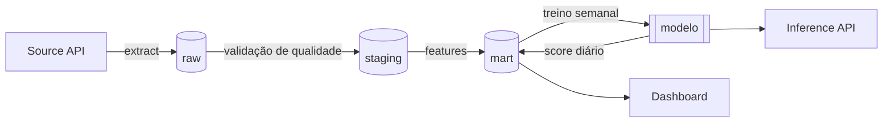
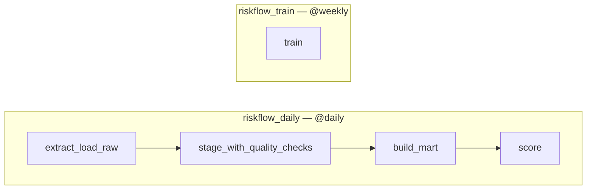

# RiskFlow

[](https://github.com/BrunoMoreno1702/RiskFlow/actions/workflows/ci.yml)

Pipeline de dados incremental para transações de cartão. Os dados são ingeridos, validados e organizados
em camadas no PostgreSQL. Um modelo de detecção de fraude, orquestrado pelo Airflow, pontua as transações todos os dias.

**Stack:** Python · PostgreSQL · Apache Airflow 3 · FastAPI · scikit-learn · Streamlit · Docker · GitHub Actions

## Arquitetura



**Principais decisões:**
- **Incremental e idempotente:** cada execução processa um dia, e reprocessar não duplica dados.
- **Qualidade bloqueante:** se uma checagem falha, o dia é rejeitado antes de chegar à staging.
- **Features point-in-time:** só usam o passado do cliente, e a mesma função serve ao batch, ao treino e à API.
- **Avaliação temporal por PR-AUC:** com cerca de 1% de fraude, acurácia não diz nada.

Detalhes em [Detalhes técnicos](#detalhes-técnicos).

## Como rodar

Requer Docker, com cerca de 8 GB de RAM disponíveis.

```bash
docker compose up -d --build
docker compose run --rm pipeline backfill --start 2026-06-01 --end 2026-09-30
docker compose run --rm pipeline train
docker compose run --rm pipeline score --start 2026-06-01 --end 2026-09-30
```

| Serviço | Endereço |
|---|---|
| Airflow | http://localhost:8080 |
| Dashboard | http://localhost:8501 |
| Inference API | http://localhost:8000/docs |

## Resultados

Teste com 13.375 transações e 125 fraudes, em dias posteriores aos usados no treino:

| Modelo | PR-AUC | Precision | Recall |
|---|---|---|---|
| Regra simples: valor > p95 | 0,024 | 0,040 | 0,216 |
| **HistGradientBoosting** | **0,939** | **0,810** | **0,888** |

**Limitações:** os dados são sintéticos, então as métricas são otimistas. Além disso, o rótulo de fraude chega junto com a transação; na prática, ele chega dias depois, por chargeback.

## Detalhes técnicos

### Camadas

| Camada | Conteúdo | Por quê |
|---|---|---|
| `raw.transactions` | Payload JSON exatamente como chegou, com `batch_date` e `ingested_at` | É a fonte da verdade. Uma mudança na transformação pode ser reaplicada sem consultar a origem de novo. |
| `staging.transactions` | Dados tipados, padronizados e deduplicados, com constraints | Só entram dados que passaram pelas checagens de qualidade. |
| `mart.fct_transactions` | Tabela fato com 13 features por transação | É a camada de consumo do modelo e do dashboard. |
| `mart.fraud_scores` | Score, predição, threshold e versão do modelo | Tem `ON DELETE CASCADE`: reconstruir um dia apaga os scores antigos, então nunca existe score calculado sobre features desatualizadas. |

O schema está em [sql/001_schema.sql](sql/001_schema.sql) e é idempotente.

### Incremental e idempotente

- **Cada etapa processa um único dia.** Para gravar, ela apaga o dia e o regrava dentro da mesma transação. Reexecutar um dia produz exatamente o mesmo resultado; isso é verificado no CI.
- **A origem é determinística.** A mesma data sempre devolve as mesmas transações, com IDs UUIDv5 derivados de seed, data, cliente e sequência. Sem isso, um reprocessamento traria dados diferentes.

### Qualidade de dados

As checagens rodam sobre o lote do dia, antes de qualquer escrita na staging ([pipeline/quality.py](pipeline/quality.py)). Se uma falhar, o dia inteiro é rejeitado: um dia faltando é visível e alertável, enquanto um dia errado contamina o mart sem ninguém perceber.

| Checagem | Regra |
|---|---|
| `not_empty` | O dia tem pelo menos uma transação |
| `no_nulls` | Campos obrigatórios preenchidos |
| `unique_transaction_id` | Nenhum ID repetido no lote |
| `amount_positive` / `amount_upper_bound` | Valor entre 0 e 100 mil |
| `event_date_matches_batch` | Todas as transações pertencem ao dia processado |
| `is_fraud_binary` | Rótulo é 0 ou 1 |
| `fraud_rate_plausible` | Taxa de fraude abaixo de 10% (acima disso, o problema provavelmente é da origem) |

### Orquestração



- **Cada execução processa o dia anterior** à sua data lógica.
- **`depends_on_past` e `max_active_runs=1`:** as features de um dia dependem do histórico dos dias anteriores. Sem `depends_on_past`, o backfill do Airflow 3 processa vários dias em paralelo (ele tem um limite de paralelismo próprio) e cria uma condição de corrida. Esse problema apareceu durante a validação e foi corrigido.
- **Retries** para falhas transitórias, como a origem fora do ar. A checagem de qualidade não tem retry, porque dado errado não se corrige tentando de novo.
- **Treino em processo isolado** (`@task.bash`). O Airflow importa o `dill`, que altera o pickler global do Python. Se o treino rodasse dentro do processo do Airflow, o modelo salvo dependeria do `dill` e a API de inferência não conseguiria carregá-lo.
- **A lógica fica em `pipeline/` e `ml/`, não nas DAGs.** As tasks só chamam funções que podem ser testadas sem o Airflow e que também rodam pela CLI.

### Modelo

**Features** ([ml/features.py](ml/features.py)): todas são point-in-time, ou seja, calculadas só com transações anteriores do mesmo cliente.
- quantidade de compras na última hora, nas últimas 24 horas e nos últimos 30 dias
- valor médio do cliente em 30 dias e razão entre o valor atual e essa média
- se a categoria é nova para o cliente
- hora, madrugada, fim de semana, categoria e bandeira

A mesma função é usada no batch, no treino e na API online. Para isso, a API busca o histórico de 30 dias do cliente na staging. Assim não há divergência entre o que o modelo viu no treino e o que ele recebe em produção.

**Avaliação** ([ml/train.py](ml/train.py)):
- **Split temporal por dia:** 70% para treino, 15% para validação e 15% para teste. O modelo é sempre avaliado em dias posteriores aos que viu no treino.
- **Seleção por PR-AUC** na validação. Com 0,9% de fraude, acurácia não diz nada: um modelo que nunca aponta fraude teria 99% de acurácia.
- **Threshold** escolhido na validação, com as métricas reportadas no teste.
- **Comparação com a regra simples** "valor acima do p95". O modelo só se justifica se for claramente melhor que ela.

### CI

[.github/workflows/ci.yml](.github/workflows/ci.yml) roda três jobs a cada push:
1. **lint-and-test:** ruff e pytest.
2. **dags:** build da imagem do Airflow e verificação de que as DAGs importam sem erro.
3. **end-to-end:** sobe o Postgres e a Source API e faz backfill de 45 dias. Depois verifica que reprocessar um dia não duplica dados, treina, pontua um dia novo e chama a API de inferência.

## Próximos passos

- Tratar rótulos atrasados (chargeback)
- Migrar as transformações para dbt
- Alertas de qualidade de dados e monitoramento de drift do modelo
